<h1 align="center">💊 Farmasi Solusi Kita</h1>

<p align="center">
  <b>Apotek online (e-commerce farmasi) berbasis Laravel 12</b><br>
  Katalog obat, keranjang belanja, checkout, lacak pesanan, portal pelanggan, dan panel admin lengkap.
</p>

<p align="center">
  
  
  
  
  
  
</p>

<p align="center">
  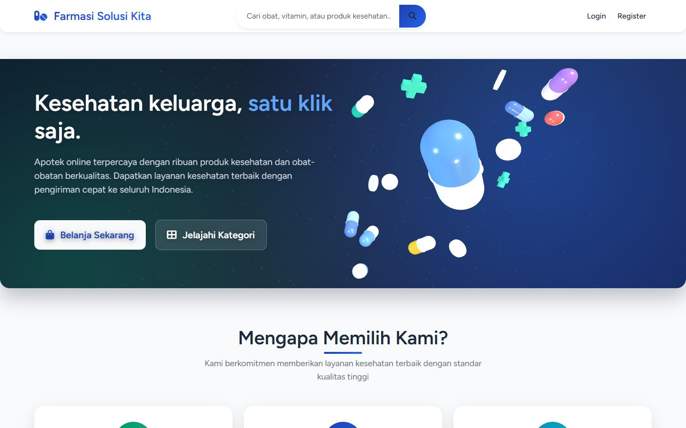
</p>

---

## 📑 Daftar Isi

- [Tentang Proyek](#-tentang-proyek)
- [Fitur Utama](#-fitur-utama)
- [Tampilan Website](#-tampilan-website)
- [Tampilan Mobile](#-tampilan-mobile)
- [Spesifikasi Teknis](#-spesifikasi-teknis)
- [Struktur Database](#-struktur-database)
- [Alur Pemesanan](#-alur-pemesanan)
- [Instalasi](#-instalasi)
- [Akun Demo](#-akun-demo)
- [Daftar Halaman & Route](#-daftar-halaman--route)
- [Struktur Folder](#-struktur-folder)
- [Pengujian](#-pengujian)

---

## 📖 Tentang Proyek

**Farmasi Solusi Kita** adalah aplikasi web apotek online yang memudahkan pelanggan membeli obat, vitamin, dan alat kesehatan dari rumah, sekaligus membantu pemilik apotek mengelola produk, stok, pesanan, pelanggan, dan laporan penjualan dari satu panel admin.

Website ini punya tiga sisi:

| Sisi | Untuk siapa | Fungsi |
|---|---|---|
| **Toko (katalog)** | Pengunjung & pelanggan | Melihat produk, mencari obat, melihat detail & stok, menambah ke keranjang |
| **Portal pelanggan** | Pelanggan yang sudah login | Checkout, riwayat & lacak pesanan, membatalkan pesanan, mengelola profil |
| **Panel admin** | Admin apotek | Kelola produk, kategori, pesanan, pelanggan, laporan, dan pengaturan toko |

Tampilan memakai tema biru navy yang konsisten di semua halaman, dengan **animasi kapsul 3D interaktif (Three.js)** di beranda, halaman login, dan dashboard pelanggan.

---

## ✨ Fitur Utama

### 🛍️ Toko & Katalog
- **Beranda** dengan hero animasi 3D, keunggulan toko, kategori, produk unggulan, produk terbaru, statistik, newsletter, dan testimoni.
- **Katalog produk** dengan sidebar kategori (beserta jumlah produk), filter rentang harga & jenis obat, serta pengurutan.
- **Pencarian** obat/vitamin/alat kesehatan dari kolom pencarian di navbar.
- **Halaman per kategori** (Obat Bebas, Obat Keras, Vitamin & Suplemen, Perawatan Kulit, Kesehatan Bayi & Anak, Alat Kesehatan, Herbal & Tradisional, Nutrisi & Diet).
- **Detail produk** lengkap: harga & harga diskon, SKU, brand, produsen, stok, tanggal kedaluwarsa, nomor batch, berat, aturan pakai, efek samping, dan kontraindikasi.
- Label **Produk Unggulan**, **persentase diskon**, dan **Resep Dokter** untuk obat keras.

### 🛒 Keranjang & Checkout
- Ikon keranjang hanya tampil **setelah login**, lengkap dengan jumlah item.
- Tambah, ubah jumlah, hapus item, atau kosongkan keranjang (dicek terhadap stok tersedia).
- Ringkasan pesanan otomatis: subtotal, diskon, ongkos kirim, pajak, dan total.
- **Checkout** dengan data penerima & alamat pengiriman.
- Tiga metode pembayaran: **Transfer Bank**, **E-Wallet**, dan **Bayar di Tempat (COD)**.
- Stok berkurang otomatis saat pesanan dibuat (diproses dalam satu transaksi database).

### 👤 Portal Pelanggan
- **Dashboard pelanggan** dengan hero 3D, ringkasan pesanan (total, sedang berjalan, selesai, total belanja), lacak pesanan aktif, dan rekomendasi produk.
- **Riwayat pesanan** & **detail pesanan** dengan status pengiriman.
- **Batalkan pesanan** yang masih `pending` dan belum dibayar (stok dikembalikan otomatis).
- **Profil**: lihat & ubah data diri, ganti password, hapus akun.
- Registrasi, login, lupa password, dan verifikasi email (Laravel Breeze).

### 🧑‍💼 Panel Admin
- **Dashboard**: total produk, kategori, stok rendah, stok habis, total pesanan, pengguna, keranjang aktif, produk terbaru, dan peringatan stok rendah.
- **Manajemen produk**: CRUD produk, upload gambar, tandai unggulan, dan **update stok massal**.
- **Manajemen kategori**: CRUD kategori dan aktif/nonaktifkan kategori.
- **Manajemen pesanan**: buat/ubah pesanan, ubah status pesanan & status pembayaran, cetak **invoice** dan **label pengiriman**, serta ekspor data pesanan.
- **Manajemen pelanggan**: CRUD pelanggan, verifikasi akun, dan ekspor data pelanggan.
- **Laporan**: laporan penjualan, produk, pelanggan, dan inventori per rentang tanggal, dengan grafik dan ekspor **PDF (halaman cetak)** atau **CSV (bisa dibuka di Excel)**.
- **Pengaturan toko**: nama & deskripsi toko, kontak, alamat, mata uang, tarif pajak, ongkos kirim, mode maintenance, notifikasi email, timeout sesi, logo, favicon, media sosial, **backup database**, dan **bersihkan cache**.

### 🔒 Keamanan
- Rute admin dilindungi middleware `auth` + `admin`; rute checkout & portal pelanggan dilindungi `auth`.
- Proteksi CSRF di semua form, validasi input di setiap controller.
- *Rate limiting* pada endpoint laporan (`throttle`).
- **Mode maintenance** yang bisa diaktifkan dari panel pengaturan (middleware `CheckMaintenanceMode`).

---

## 🖥️ Tampilan Website

### Beranda
<p align="center">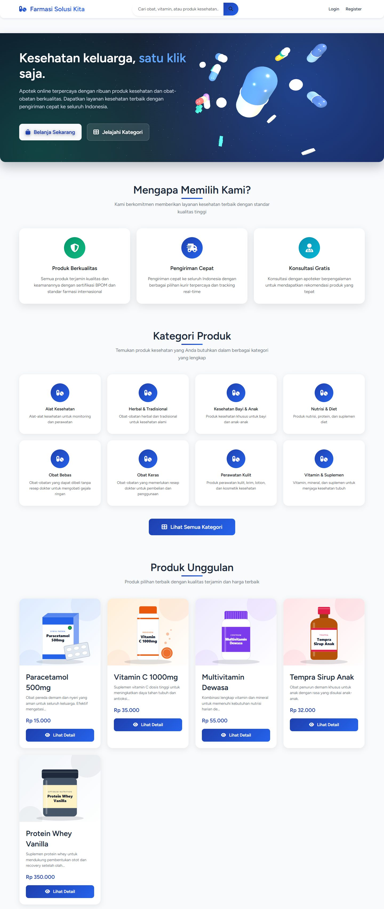</p>

### Katalog Produk & Detail Produk
<table>
  <tr>
    <td width="50%">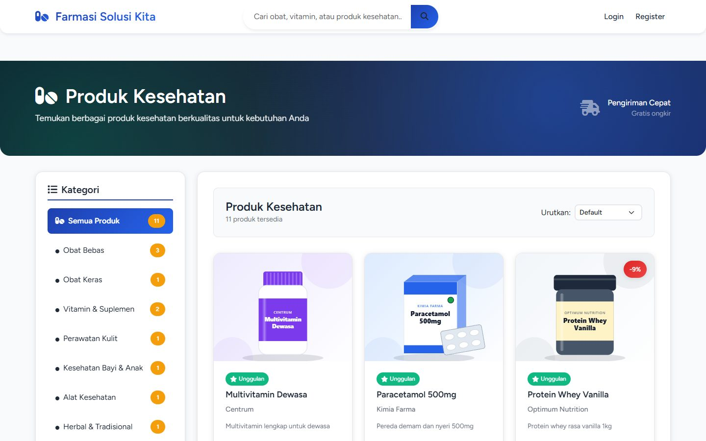</td>
    <td width="50%">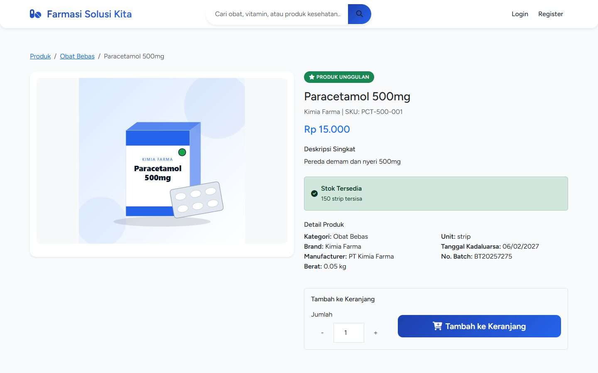</td>
  </tr>
  <tr>
    <td align="center"><b>Katalog</b>: sidebar kategori, filter harga, dan kartu produk</td>
    <td align="center"><b>Detail produk</b>: info obat, stok, dan tombol keranjang</td>
  </tr>
</table>

### Keranjang & Checkout
<table>
  <tr>
    <td width="50%">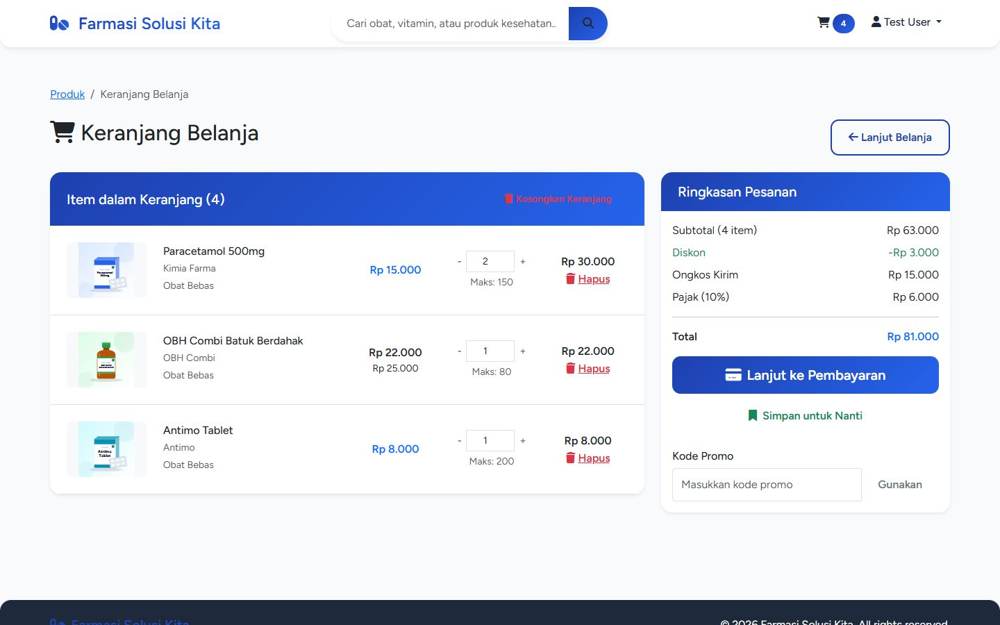</td>
    <td width="50%">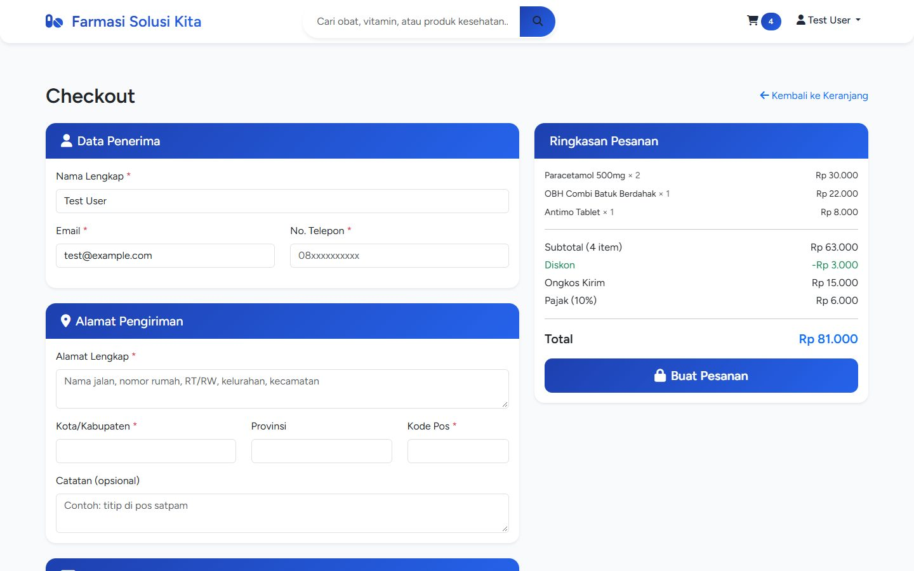</td>
  </tr>
  <tr>
    <td align="center"><b>Keranjang</b>: ubah jumlah & ringkasan biaya</td>
    <td align="center"><b>Checkout</b>: alamat pengiriman & metode pembayaran</td>
  </tr>
</table>

### Login & Dashboard Pelanggan
<table>
  <tr>
    <td width="50%">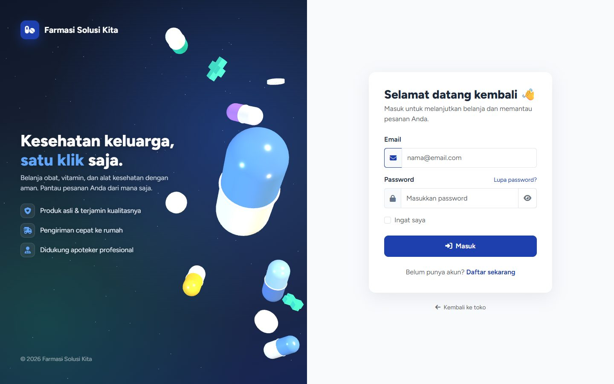</td>
    <td width="50%">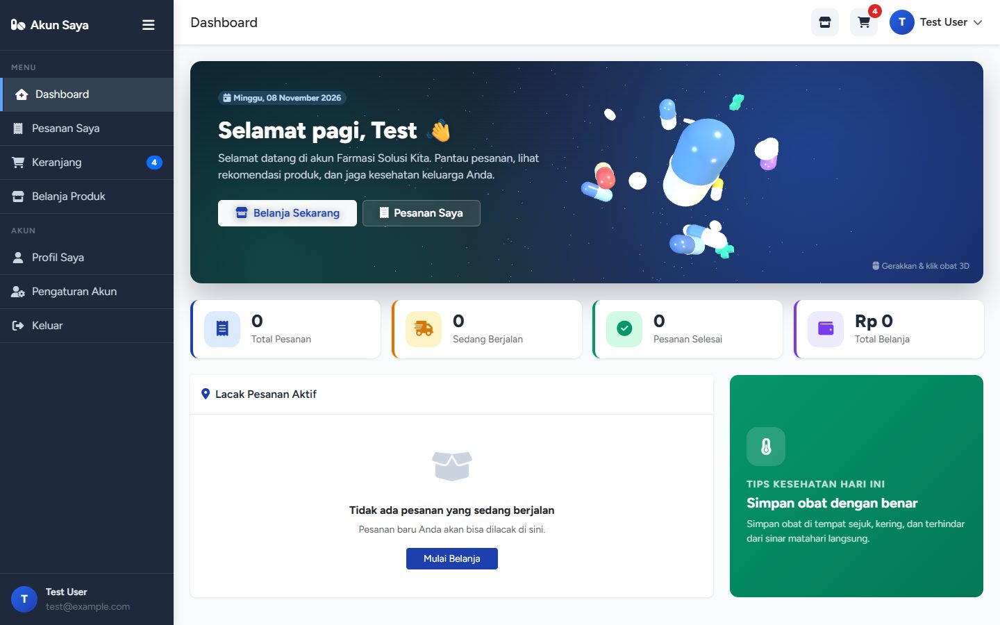</td>
  </tr>
  <tr>
    <td align="center"><b>Login</b> dengan animasi kapsul 3D</td>
    <td align="center"><b>Dashboard pelanggan</b>: ringkasan & lacak pesanan</td>
  </tr>
</table>

### Panel Admin
<table>
  <tr>
    <td width="50%">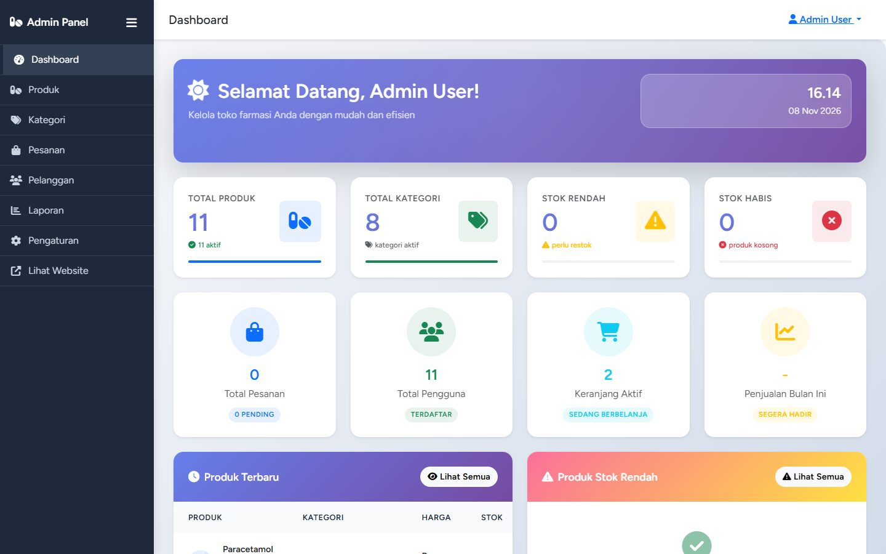</td>
    <td width="50%">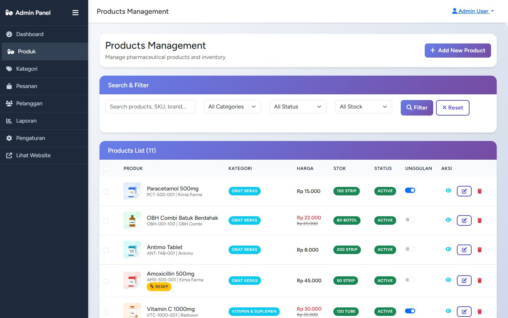</td>
  </tr>
  <tr>
    <td align="center"><b>Dashboard admin</b></td>
    <td align="center"><b>Kelola produk</b></td>
  </tr>
  <tr>
    <td width="50%">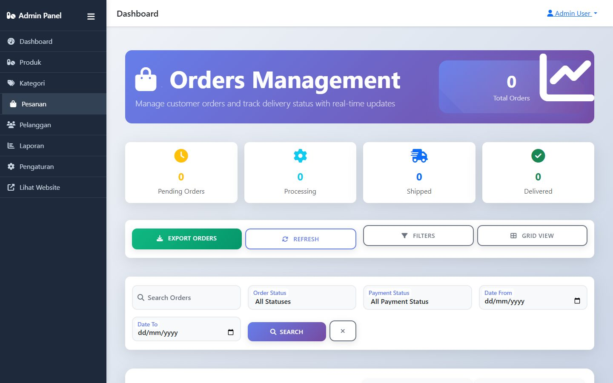</td>
    <td width="50%">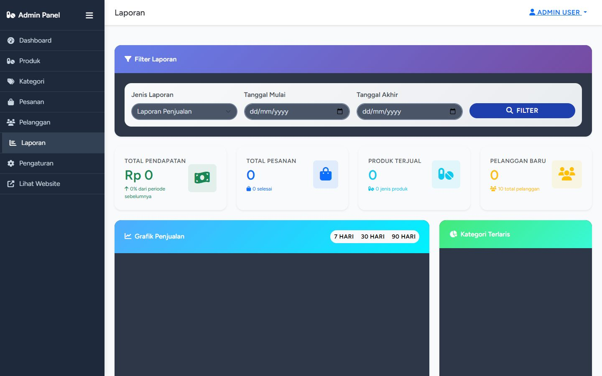</td>
  </tr>
  <tr>
    <td align="center"><b>Kelola pesanan</b></td>
    <td align="center"><b>Laporan & grafik</b></td>
  </tr>
</table>

---

## 📱 Tampilan Mobile

Seluruh halaman responsif dan nyaman dipakai di HP (diuji pada lebar layar 390 px).

<table>
  <tr>
    <td align="center">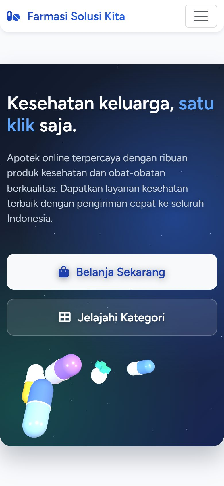<br><b>Beranda</b></td>
    <td align="center">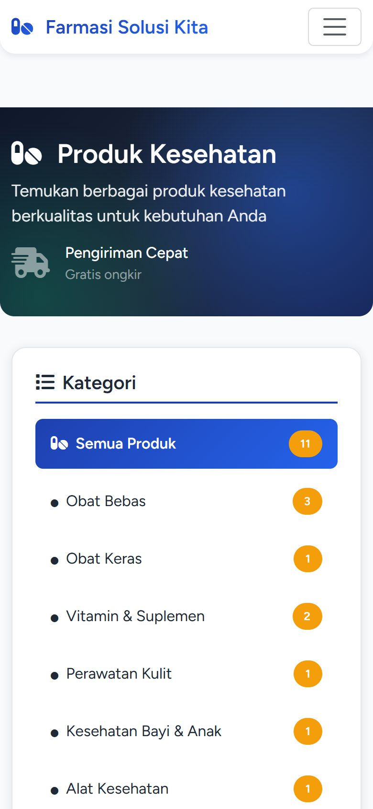<br><b>Katalog</b></td>
    <td align="center">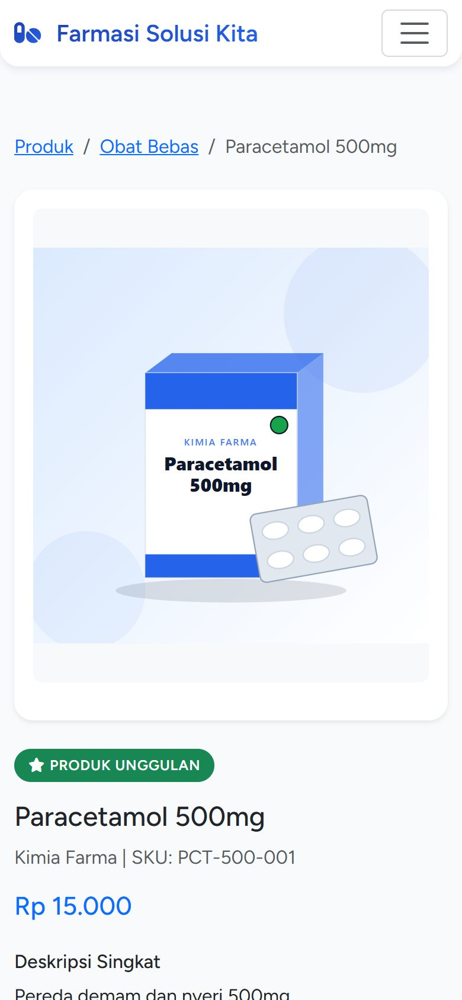<br><b>Detail Produk</b></td>
  </tr>
  <tr>
    <td align="center">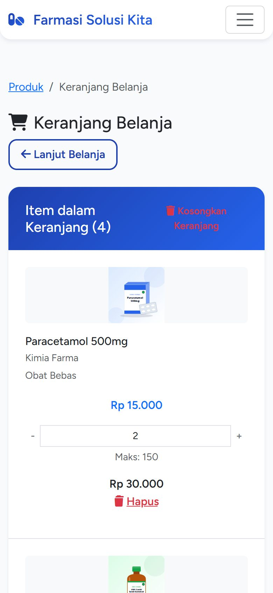<br><b>Keranjang</b></td>
    <td align="center">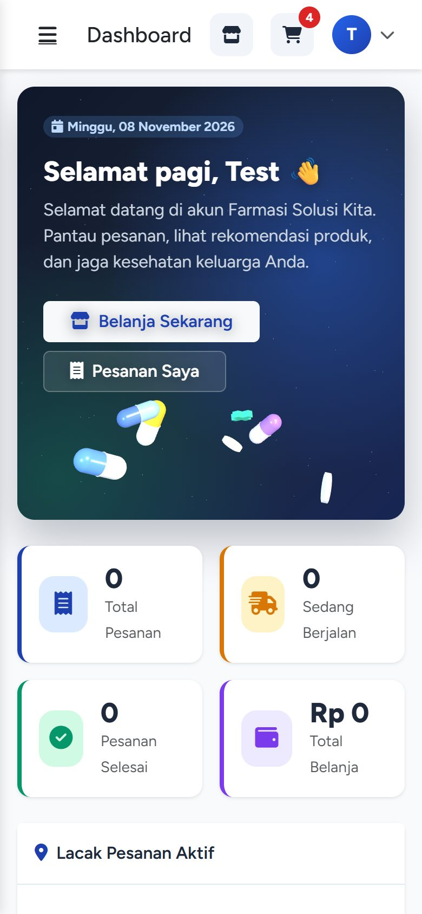<br><b>Dashboard Pelanggan</b></td>
    <td align="center">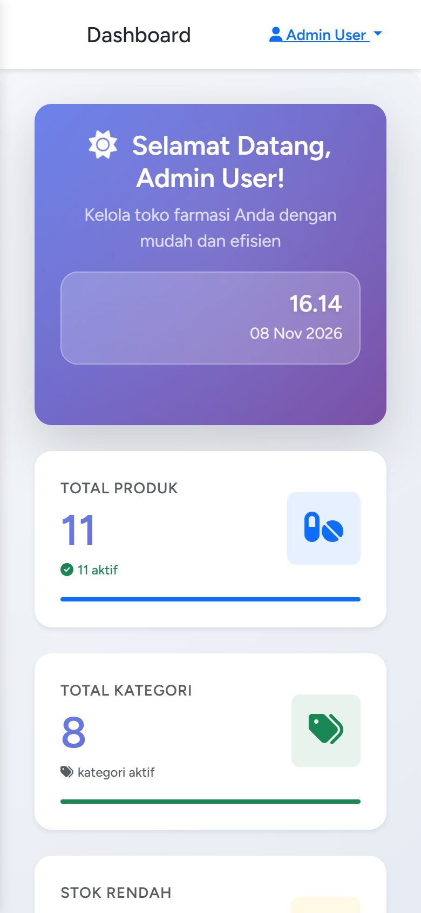<br><b>Dashboard Admin</b></td>
  </tr>
</table>

---

## ⚙️ Spesifikasi Teknis

| Komponen | Teknologi |
|---|---|
| Bahasa | PHP 8.2+ |
| Framework backend | Laravel 12 |
| Autentikasi | Laravel Breeze (login, register, lupa password, verifikasi email) |
| Template | Blade |
| UI / CSS | Bootstrap 5.3, CSS kustom per halaman (`public/css`), Font Awesome 6 |
| Animasi 3D | Three.js r128 + `public/js/pharma-3d.js` (fallback CSS bila WebGL tidak tersedia) |
| Build tool aset | Vite 6 + Tailwind CSS 3 (untuk halaman bawaan Breeze) |
| Database | SQLite (default) atau MySQL |
| ORM | Eloquent |
| Testing | PHPUnit 11 |
| Font | Figtree (Bunny Fonts) |

**Kebutuhan sistem:** PHP ≥ 8.2 (ekstensi `pdo_sqlite`/`pdo_mysql`, `mbstring`, `openssl`, `fileinfo`), Composer 2, Node.js ≥ 18, dan npm.

---

## 🗄️ Struktur Database

| Tabel | Keterangan |
|---|---|
| `users` | Pelanggan & admin (kolom `is_admin`) |
| `categories` | Kategori produk (nama, slug, deskripsi, status aktif) |
| `products` | Produk obat: harga, harga diskon, SKU, stok, brand, produsen, kedaluwarsa, batch, resep dokter, aturan pakai, efek samping, kontraindikasi, berat, unit, unggulan |
| `carts` | Isi keranjang per pengguna |
| `orders` | Pesanan: nomor pesanan, data penerima, alamat, metode & status pembayaran, status pesanan, total |
| `order_items` | Item tiap pesanan (produk, jumlah, harga saat dibeli) |
| `settings` | Pengaturan toko (key–value) |

Relasi singkat: `Category 1─N Product`, `User 1─N Order`, `Order 1─N OrderItem N─1 Product`, `User 1─N Cart N─1 Product`.

Diagram tabel lengkap tersedia di [`database/Tabel DataBaseSQL.pdf`](database/Tabel%20DataBaseSQL.pdf).

**Status pesanan:** `pending` → `processing` → `shipped` → `delivered` (atau `cancelled`)
**Status pembayaran:** `pending`, `paid`, `failed`, `refunded`

---

## 🔄 Alur Pemesanan

```
Pengunjung ──► Lihat katalog / cari obat ──► Detail produk
                                               │
                                     Login / Register
                                               │
                                               ▼
           Tambah ke keranjang ──► Keranjang ──► Checkout (alamat + metode bayar)
                                                          │
                                                          ▼
                                            Pesanan dibuat (stok berkurang)
                                                          │
          Admin: ubah status pembayaran & pesanan ◄───────┤
          (processing ► shipped ► delivered)              │
                                                          ▼
                                  Pelanggan memantau di Dashboard / Pesanan Saya
```

---

## 🚀 Instalasi

```bash
# 1. Clone repository
git clone https://github.com/whympxx/E-commerce-FarmasiSolusiKita.git
cd E-commerce-FarmasiSolusiKita

# 2. Install dependensi PHP & JavaScript
composer install
npm install

# 3. Siapkan file environment
cp .env.example .env
php artisan key:generate

# 4. Siapkan database (default SQLite)
touch database/database.sqlite        # Windows: type nul > database\database.sqlite
php artisan migrate --seed

# 5. Hubungkan folder gambar produk
php artisan storage:link

# 6. Jalankan aplikasi
php artisan serve
```

Buka **http://localhost:8000** di browser.

> **Memakai MySQL?** Ubah bagian database di `.env`:
> ```env
> DB_CONNECTION=mysql
> DB_HOST=127.0.0.1
> DB_PORT=3306
> DB_DATABASE=farmasi_solusi_kita
> DB_USERNAME=root
> DB_PASSWORD=
> ```
> lalu jalankan `php artisan migrate --seed`.

> **Catatan:** Halaman toko, pelanggan, dan admin memakai Bootstrap dari CDN, jadi cukup `php artisan serve`. Jalankan `npm run dev` (atau `npm run build`) hanya jika mengubah aset Vite/Tailwind di `resources/`.

---

## 🔑 Akun Demo

Dibuat otomatis oleh `php artisan migrate --seed`:

| Peran | Email | Password |
|---|---|---|
| Admin | `admin@farmasi.com` | `password` |
| Pelanggan | `test@example.com` | `password` |
| Pelanggan lain | `budi.santoso@email.com`, `siti.nurhaliza@email.com`, dll. | `password` |

> ⚠️ Ganti password akun demo sebelum website dipakai di server publik.

---

## 🗺️ Daftar Halaman & Route

### Toko (publik)
| URL | Halaman |
|---|---|
| `/` | Beranda |
| `/products` | Katalog semua produk |
| `/products/search?q=` | Hasil pencarian |
| `/category/{slug}` | Produk per kategori |
| `/product/{slug}` | Detail produk |
| `/login`, `/register` | Masuk & daftar |

### Pelanggan
| URL | Halaman |
|---|---|
| `/cart` | Keranjang belanja (ikon keranjang hanya tampil setelah login) |
| `/checkout` | Checkout *(wajib login, begitu juga halaman di bawah ini)* |
| `/checkout/success/{order}` | Pesanan berhasil |
| `/dashboard` | Dashboard pelanggan |
| `/orders`, `/orders/{order}` | Riwayat & detail pesanan |
| `/profile`, `/profile/edit` | Profil pelanggan |

### Admin (`/admin`, wajib login sebagai admin)
| URL | Halaman |
|---|---|
| `/admin/dashboard` | Dashboard admin |
| `/admin/products` | Kelola produk |
| `/admin/categories` | Kelola kategori |
| `/admin/orders` | Kelola pesanan, invoice, label kirim |
| `/admin/customers` | Kelola pelanggan |
| `/admin/reports` | Laporan & ekspor |
| `/admin/settings` | Pengaturan toko |

---

## 📂 Struktur Folder

```
├── app/
│   ├── Http/Controllers/        # Controller toko, keranjang, checkout, pesanan, profil
│   │   └── Admin/               # Controller panel admin
│   ├── Http/Middleware/         # AdminMiddleware, CheckMaintenanceMode
│   └── Models/                  # User, Category, Product, Cart, Order, OrderItem, Setting
├── database/
│   ├── migrations/              # Struktur tabel
│   └── seeders/                 # Data awal: admin, pelanggan, kategori, produk, pengaturan
├── public/
│   ├── css/                     # CSS per halaman (home, products, admin-*)
│   └── js/                      # JS per halaman + pharma-3d.js (animasi 3D)
├── resources/views/
│   ├── layouts/                 # catalog, customer, admin, guest
│   ├── home.blade.php           # Beranda
│   ├── products/ cart/ checkout/ orders/ customer/ profile/
│   └── admin/                   # Halaman panel admin
├── routes/web.php               # Semua route website
├── docs/screenshots/            # Gambar untuk README
└── tests/                       # Pengujian otomatis
```

---

## 🧪 Pengujian

```bash
php artisan test
```

Mencakup pengujian autentikasi (Breeze), profil, dan alur belanja (`tests/Feature/ShopFlowTest.php`).

---

<p align="center">
  Dibuat dengan ❤️ menggunakan Laravel · © Farmasi Solusi Kita
</p>
